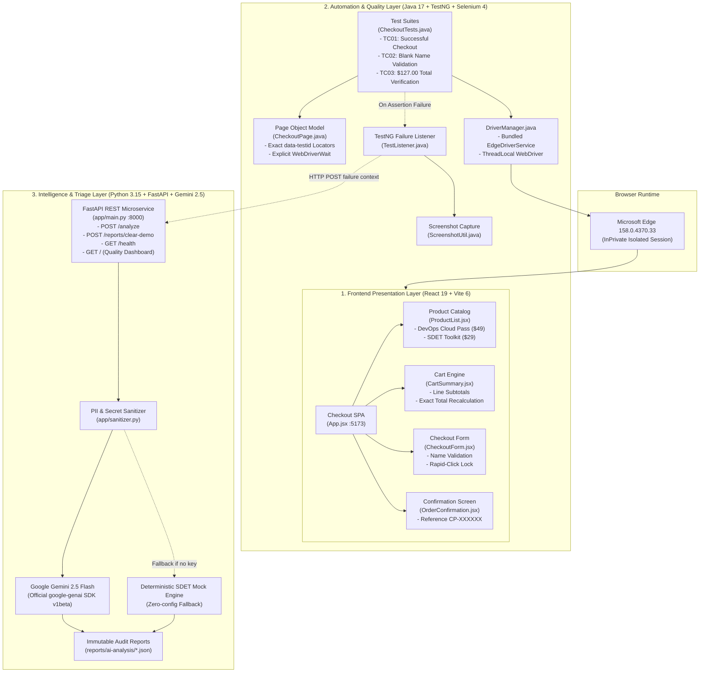

# CheckoutProof AI

> **Reliable Checkout. Verified Every Time.**

[](reports/automation/index.html)
[](frontend/)
[](ai-service/)
[](automation/)

CheckoutProof AI is an enterprise-grade e-commerce quality assurance platform. It pairs a high-performance single-page checkout application with automated **Selenium WebDriver** browser tests running on **Microsoft Edge** and an intelligent **AI Failure Triage microservice** powered by **Google Gemini 2.5 Flash**.

---

## 1. Problem Statement

Checkout is the most financially vulnerable touchpoint in e-commerce. A single defect—whether an arithmetic rounding discrepancy, a broken required-field validation rule, or an unhandled double-click submission—leads directly to lost revenue, cart abandonment, and customer dissatisfaction.

Furthermore, when automated tests fail in CI/CD pipelines, QA and SDET teams lose hours deciphering 500-line stack traces to distinguish between real application defects, selector rot, and environmental timeouts.

**CheckoutProof AI solves both challenges:**
1. A rock-solid, responsive client-side checkout experience with rigid business validation and transaction idempotency.
2. Automated, deterministic browser verification with zero flaky waits.
3. Instant, automated failure triage powered by Google Gemini that explains *what* broke, *why* it broke, and generates ready-to-file Jira bug reports.

---

## 2. Project Overview & Features

### 🛒 Client-Side Checkout Experience (`frontend/`)
* **Two Synthetic Catalog Products:**
  * **DevOps Cloud Pass** — `$49.00`
  * **SDET Automation Toolkit** — `$29.00`
* **Real-Time Reactive Cart:**
  * Add, increment, decrement, and remove items with instant line-item subtotal calculations and reactive order total recalculation (**$127.00 exact arithmetic verification**).
* **Rigid Validation & Form Preservation:**
  * Blocks checkout when the cart is empty or when Customer Name is blank.
  * Preserves entered form fields upon validation errors—users never lose their input.
* **Transaction Idempotency (Rapid Multi-Click Lock):**
  * Submitting an order immediately transitions the button to a disabled state (`disabled={true}`) with an animated loading spinner (`Processing Order...`), preventing duplicate orders or multiple charges.
* **Immutable Confirmation:**
  * Successful checkout renders a clean confirmation receipt featuring a unique tracking code (format: `CP-XXXXXX`).

### 🧪 Selenium WebDriver Automation (`automation/`)
* **Page Object Model (POM):** Decoupled, maintainable architecture in `CheckoutPage.java`.
* **Zero Fragile Selectors:** 100% of automation locators use dedicated `data-testid` attributes decoupled from styling.
* **Deterministic Synchronization:** Explicit `WebDriverWait` with `ExpectedConditions`; no arbitrary `Thread.sleep`.
* **Session Isolation:** Every test executes in an isolated Microsoft Edge instance using `--inprivate` mode with clean cookies and cache.
* **Bundled EdgeDriver:** Local official driver matching Edge 158.0.4370.33, completely eliminating flaky external download dependencies.

### 🤖 Intelligent Failure Triage Microservice (`ai-service/`)
* **Authoritative Truth Boundary:** Selenium assertions remain the **sole source of truth** for test verdicts. AI triage acts strictly as an advisory diagnostic layer.
* **Google Gemini 2.5 Flash:** Intercepts test failure stack traces, DOM state, and screenshots to produce structured root-cause analyses, debugging steps, and Jira-ready bug reports.
* **Zero-Trust Data Sanitization:** Scrubs credit cards, email addresses, auth tokens, and local user directory paths before payload ingestion.
* **Dual-Engine Architecture:** Seamlessly switches between live **Google Gemini 2.5 Flash** and a deterministic **SDET Mock Fallback Engine** if no API key is configured.
* **Interactive Quality Dashboard:** Modern web UI on port 8000 with real-time test execution summaries, filterable diagnostic cards, and a **Clear Demo Reports** utility.

---

## 3. Technology Stack

| Domain | Technology | Version | Purpose |
| :--- | :--- | :--- | :--- |
| **Frontend Framework** | React / Vite | React 19.2.4 / Vite 6.4.6 | Responsive Single Page Application |
| **Language** | JavaScript (ES6+) | Node.js 26.13.1 | Client runtime |
| **Styling** | Modern Vanilla CSS | CSS3 (Grid & Flexbox) | Accessible, high-contrast e-commerce UI |
| **Test Automation** | Java JDK | Eclipse Adoptium OpenJDK 17.0.21.1 | Enterprise test harness environment |
| **Build & Dependencies** | Apache Maven | 3.10.1 | Lifecycle and dependency management |
| **Test Runner** | TestNG | 7.10.2 | Test annotations, suites, and listeners |
| **Browser Driver** | Selenium WebDriver | 4.28.1 (Java) | W3C WebDriver browser orchestration |
| **Target Browser** | Microsoft Edge | 158.0.4370.33 (64-bit) | Browser under test (InPrivate mode) |
| **AI Microservice** | Python / FastAPI | Python 3.15 / FastAPI 0.115 | Asynchronous failure triage REST API |
| **ASGI Server** | Uvicorn | 0.54.0 | High-concurrency async web server |
| **AI LLM Engine** | Google Gemini | Gemini 2.5 Flash (`google-genai` SDK v1beta) | Root cause diagnosis & bug report drafting |

---

## 4. Architecture Overview

### System Architecture Diagram


### The Authoritative Truth Boundary
CheckoutProof AI enforces strict engineering boundaries between automated testing and artificial intelligence:
- **TestNG Assertions = Truth:** The test verdict (`PASS` or `FAIL`) is governed exclusively by standard Selenium WebDriver assertions.
- **AI Triage = Advisory:** AI failure analyses never alter or overturn test verdicts. Instead, they provide deep diagnostic context, suggested debugging steps, and formatted bug reports for software engineers.

---

## 5. Project Directory Structure

```text
checkoutproof-ai/
├── frontend/                                   # Module 1: React 19 + Vite Checkout Application
│   ├── src/
│   │   ├── components/
│   │   │   ├── ProductList.jsx                 # 2 Synthetic products with data-testid selectors
│   │   │   ├── CartSummary.jsx                 # Dynamic line subtotals & total calculation
│   │   │   ├── CheckoutForm.jsx                # Form validation, error banner, rapid-click lock
│   │   │   └── OrderConfirmation.jsx           # Order confirmation & CP-XXXXXX reference
│   │   ├── App.jsx                             # Root checkout state & business rules
│   │   ├── App.css                             # Modern responsive CSS
│   │   └── main.jsx                            # React 19 entry point
│   ├── package.json                            # Minimal dependencies
│   ├── vite.config.js                          # Port 5173 configuration
│   └── .gitignore                              # Excludes node_modules/ & dist/
│
├── automation/                                 # Module 2: Java 17 + Selenium + TestNG Suite
│   ├── pom.xml                                 # Maven dependencies: Selenium 4.28.1, TestNG 7.10.2
│   ├── testng.xml                              # Regression test suite configuration
│   ├── drivers/
│   │   └── msedgedriver.exe                    # Bundled official EdgeDriver (v158.0.4370.33)
│   ├── src/
│   │   ├── main/java/com/checkoutproof/
│   │   │   ├── pages/
│   │   │   │   └── CheckoutPage.java           # POM with explicit WebDriverWait & data-testid
│   │   │   └── utils/
│   │   │       ├── DriverManager.java          # InPrivate Edge session manager
│   │   │       └── ScreenshotUtil.java         # Failure screenshot capture utility
│   │   └── test/java/com/checkoutproof/
│   │       ├── base/
│   │       │   └── BaseTest.java               # Lifecycle setup and teardown
│   │       ├── listeners/
│   │       │   └── TestListener.java           # TestNG listener dispatching failure telemetry
│   │       └── tests/
│   │           ├── CheckoutTests.java          # 3 Core automated regression tests
│   │           └── ManualVerificationRunner.java # Edge verification of manual test scenarios
│   └── .gitignore                              # Excludes target/ & drivers/*.exe
│
├── ai-service/                                 # Module 3: Python FastAPI + Gemini Microservice
│   ├── app/
│   │   ├── main.py                             # FastAPI endpoints & HTML Quality Dashboard
│   │   ├── models.py                           # Pydantic data schemas with execution metadata
│   │   ├── gemini_engine.py                    # Official google-genai SDK & mock fallback
│   │   └── sanitizer.py                        # PII and token redaction module
│   ├── requirements.txt                        # FastAPI, Uvicorn, google-genai, python-dotenv
│   ├── .env.example                            # Configuration template (GEMINI_API_KEY)
│   ├── README.md                               # AI microservice technical documentation
│   └── .gitignore                              # Excludes .env & __pycache__/
│
├── reports/                                    # Genuine Test Execution Evidence
│   ├── automation/                             # TestNG HTML reports & testng-results.xml
│   ├── screenshots/                            # Failure screenshots captured during runs
│   ├── manual-testing/                         # High-res screenshots of manual test scenarios
│   │   ├── manual_empty_cart_blocked.png       # Evidence for empty cart prevention
│   │   └── manual_rapid_click_single_order.png # Evidence for multi-click idempotency
│   └── ai-analysis/                            # Immutable JSON AI diagnostic reports
│
├── docs/                                       # Project Documentation
│   ├── ARCHITECTURE.md                         # Full architecture & Truth Boundary details
│   ├── TEST_PLAN.md                            # Comprehensive test strategy & scenario matrix
│   ├── MANUAL_TEST_RESULTS.md                  # Exploratory & manual verification records
│   └── DEMO_SCRIPT.md                          # Hackathon 5-minute presentation script
│
├── .gitignore                                  # Root-level Git exclusion rules
└── README.md                                   # Root project documentation
```

---

## 6. Installation & Setup Instructions

### Prerequisites
Verify that the following runtimes are installed on your workstation:
* **Node.js:** `v20.x` or `v26.x` (`node -v`)
* **npm:** `v10.x` or `v11.x` (`npm -v`)
* **Java JDK:** Eclipse Adoptium OpenJDK 17 (`java -version`)
* **Apache Maven:** `3.9.x` or `3.10.x` (`mvn -version`)
* **Python:** `3.10` to `3.15` (`python --version`)
* **Browser:** Microsoft Edge 158+ (64-bit)

---

## 7. Running the Application & Services

### Step 1: Start the React Checkout Frontend
Open a terminal and run:
```bash
cd frontend
npm install
npm run dev -- --host 127.0.0.1 --port 5173
```
* **Frontend Application URL:** [http://127.0.0.1:5173](http://127.0.0.1:5173)

---

### Step 2: Start the AI Failure Analysis Service
Open a second terminal and run:
```bash
cd ai-service
pip install -r requirements.txt
python -m uvicorn app.main:app --host 127.0.0.1 --port 8000
```
* **Interactive Quality Dashboard:** [http://127.0.0.1:8000](http://127.0.0.1:8000)
* **OpenAPI / Swagger REST Docs:** [http://127.0.0.1:8000/docs](http://127.0.0.1:8000/docs)
* **Service Health Check:** [http://127.0.0.1:8000/health](http://127.0.0.1:8000/health)

> **💡 Gemini API Key Configuration (Optional):**  
> CheckoutProof AI works out-of-the-box with zero configuration in **Mock / Demo mode**. To enable live **Google Gemini 2.5 Flash** triage, copy `.env.example` to `.env` in `ai-service/`:
> ```bash
> cp .env.example .env
> ```
> Add your key: `GEMINI_API_KEY=your_actual_key_here`.  
> *(The `.env` file is strictly ignored by `.gitignore` and is never committed).*

---

### Step 3: Run the Automated Selenium Tests
Open a third terminal and run:
```bash
cd automation
mvn test
```
* **TestNG HTML Suite Report:** [`reports/automation/index.html`](reports/automation/index.html)
* **Surefire Text Summary:** [`reports/automation/TestSuite.txt`](reports/automation/TestSuite.txt)

---

## 8. Test Execution Results

### 📊 Actual Automated Selenium Test Results
Executed on **Microsoft Edge 158.0.4370.33 (InPrivate)**:

```text
=== Test Suite Execution Started: Checkout Flow Verification Tests ===

[STARTING TEST] >>> testBlankCustomerNameValidation
[TEST PASSED] ✔ testBlankCustomerNameValidation

[STARTING TEST] >>> testQuantityChangeAndExactTotalVerification
[TEST PASSED] ✔ testQuantityChangeAndExactTotalVerification

[STARTING TEST] >>> testSuccessfulCheckout
[TEST PASSED] ✔ testSuccessfulCheckout

=== Test Suite Execution Finished: Checkout Flow Verification Tests ===
[INFO] Tests run: 3, Failures: 0, Errors: 0, Skipped: 0, Time elapsed: 11.80 s -- in TestSuite
[INFO] ------------------------------------------------------------------------
[INFO] BUILD SUCCESS
[INFO] ------------------------------------------------------------------------
[INFO] Total time: 13.99 s
```

### Test Scenario Breakdown:
1. **`testSuccessfulCheckout`:**  
   Adds Product 1 ($49.00), enters `"Alex Morgan"`, completes order, verifies order total `$49.00`, and confirms order reference code begins with `CP-` and is at least 8 characters.
2. **`testBlankCustomerNameValidation`:**  
   Adds Product 1 ($49.00), leaves customer name empty, attempts checkout, asserts that the error banner displays *"Customer Name is required"*, and verifies the confirmation screen is not mounted.
3. **`testQuantityChangeAndExactTotalVerification`:**  
   Adds Product 1 ($49.00) and increments to quantity 2 ($98.00 subtotal). Adds Product 2 ($29.00, quantity 1). Asserts individual line subtotals and verifies the exact final order total of **`$127.00`**.

---

## 9. Manual Testing & Visual Evidence

Detailed records and steps are documented in [`docs/MANUAL_TEST_RESULTS.md`](docs/MANUAL_TEST_RESULTS.md):

| Scenario | Objective | Observed Result | Evidence Screenshot |
| :--- | :--- | :--- | :--- |
| **TC-MAN-01: Empty Cart Prevention** | Prevent checkout when 0 items are in cart. | Error banner displays: *"Your cart is empty. Please add at least one product before placing an order."* Customer name is preserved. | [manual_empty_cart_blocked.png](reports/manual-testing/manual_empty_cart_blocked.png) |
| **TC-MAN-02: Rapid Multi-Click Idempotency** | Block duplicate orders when Place Order is clicked rapidly. | Button immediately enters disabled state with loading spinner; exactly 1 confirmation screen and 1 reference code are created. | [manual_rapid_click_single_order.png](reports/manual-testing/manual_rapid_click_single_order.png) |

---

## 10. Screenshots & Evidence Gallery

| Evidence Category | File Path | Description |
| :--- | :--- | :--- |
| **Empty Cart Prevention** | [`reports/manual-testing/manual_empty_cart_blocked.png`](reports/manual-testing/manual_empty_cart_blocked.png) | High-resolution capture of empty-cart validation banner and form retention. |
| **Multi-Click Idempotency**| [`reports/manual-testing/manual_rapid_click_single_order.png`](reports/manual-testing/manual_rapid_click_single_order.png) | Screenshot proving single order confirmation after rapid successive clicks. |
| **Automated Failure Capture**| [`reports/screenshots/testBlankCustomerNameValidation_20261123_042125407.png`](reports/screenshots/testBlankCustomerNameValidation_20261123_042125407.png) | Full-page browser screenshot automatically captured by `ScreenshotUtil.java`. |
| **TestNG HTML Report** | [`reports/automation/index.html`](reports/automation/index.html) | Native TestNG test execution dashboard showing 3/3 passed tests. |

---

## 11. Security & Privacy Notice

CheckoutProof AI adheres to strict data privacy and security standards:
- **Zero Credentials in Git:** The `.env` file containing the `GEMINI_API_KEY` is strictly excluded in root and child `.gitignore` files.
- **Pre-Ingestion PII Scrubbing:** All stack traces, DOM values, and error messages pass through regular expression filters in `app/sanitizer.py` to redact credit card numbers, email addresses, and auth tokens before reaching any external LLM endpoint.
- **Zero-Dependency Fallback:** If no API key is provided, the platform automatically runs in deterministic mock mode without network calls.

---

## 12. Future Enhancements

1. **Dockerized Cross-Browser Matrix:** Expand TestNG execution to parallel Docker containers covering Chromium, Firefox, and WebKit.
2. **Multimodal Screenshot Triage:** Pass the failure PNG directly to Gemini 2.5 Flash Vision to perform visual layout discrepancy analysis alongside DOM inspection.
3. **CI/CD GitHub Actions Workflow:** Automated headless regression runs on every Pull Request with automatic posting of AI failure summaries as GitHub PR comments.
4. **Synthetic Load & Stress Testing:** Integrate k6 or JMeter to test concurrent checkout requests against simulated inventory backends.

---

## 13. Documentation Index

* 📐 **[System Architecture Specifications](docs/ARCHITECTURE.md)**
* 📋 **[Test Strategy & Test Plan](docs/TEST_PLAN.md)**
* 📝 **[Manual Test Execution Records](docs/MANUAL_TEST_RESULTS.md)**
* 🎙️ **[Hackathon Presentation & Demo Script](docs/DEMO_SCRIPT.md)**

---

**CheckoutProof AI** — Built for the SDET Hackathon Challenge.
