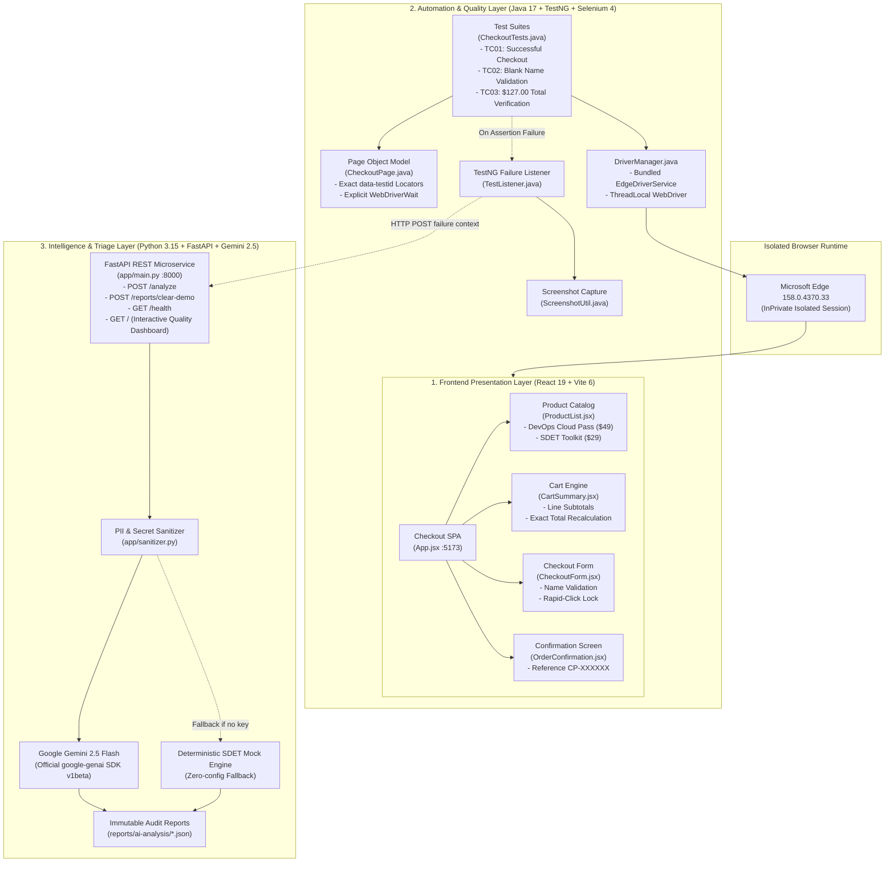
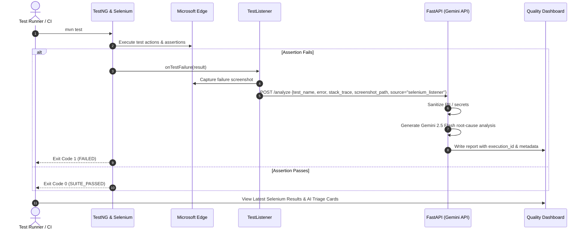

# System Architecture — CheckoutProof AI

**Tagline:** *Reliable Checkout. Verified Every Time.*  
**Version:** 1.1.0  
**Authors:** Senior Full-Stack & SDET Engineering Team

---

## 1. High-Level Architecture Overview

CheckoutProof AI is built as a three-tier decoupled quality assurance and e-commerce verification platform:

---

## 2. Core Architectural Principles

### 2.1 The Authoritative Truth Boundary
A fundamental tenet of CheckoutProof AI is the **strict separation between test verdict authority and AI failure triage**:
- **Selenium & TestNG Assertion Authority:** Browser automation assertions (`Assert.assertEquals`, `Assert.assertTrue`) are the **sole and final authority** deciding whether a test passed or failed.
- **AI Advisory Triage Role:** The Gemini AI failure analysis microservice is purely **advisory**. It generates diagnostic summaries, identifies potential code-level root causes, recommends concrete SDET debugging steps, and drafts Jira bug reports. It **never alters or overrides** official test verdicts.

---

### 2.2 SDET Locator Strategy & Decoupling
To ensure that automation tests do not break on CSS redesigns or DOM re-structuring, all interactive elements in the React application expose dedicated `data-testid` attributes:

| Target Component | `data-testid` Selector | Purpose in Automation |
| :--- | :--- | :--- |
| **Product 1 Card** | `[data-testid="product-card-1"]` | Scopes DevOps Cloud Pass card |
| **Product 1 Add** | `[data-testid="add-to-cart-btn-1"]` | Adds Product 1 to cart |
| **Product 1 Subtotal** | `[data-testid="cart-item-subtotal-1"]` | Verifies line subtotal ($98.00) |
| **Product 2 Card** | `[data-testid="product-card-2"]` | Scopes SDET Toolkit card |
| **Product 2 Add** | `[data-testid="add-to-cart-btn-2"]` | Adds Product 2 to cart |
| **Product 2 Subtotal** | `[data-testid="cart-item-subtotal-2"]` | Verifies line subtotal ($29.00) |
| **Order Total** | `[data-testid="order-total-amount"]` | Asserts exact total ($127.00) |
| **Customer Name** | `[data-testid="customer-name-input"]` | Inputs customer full name |
| **Place Order Button**| `[data-testid="place-order-btn"]` | Triggers checkout flow |
| **Error Banner** | `[data-testid="error-message-banner"]` | Asserts validation error text |
| **Confirmation Screen**| `[data-testid="order-confirmation-screen"]`| Verifies transaction success |
| **Reference Code** | `[data-testid="order-reference-number"]` | Asserts `CP-` reference number |
| **Confirmed Total**| `[data-testid="confirmed-order-total"]` | Asserts confirmed total matches |

In `CheckoutPage.java`, these locators are declared as `private final By` fields and accessed via fluent helper methods with explicit `WebDriverWait` conditions.

---

### 2.3 Session Isolation & Local Driver Architecture
- **InPrivate Clean State:** Every test execution launches an isolated Edge instance using `--inprivate` and `--remote-allow-origins=*`. No cookies, local storage, or session caches bleed between tests.
- **Bundled EdgeDriverService:** Selenium tests use an explicit, locally bundled `msedgedriver.exe` matching Microsoft Edge 158, completely bypassing flaky remote driver downloads.
- **ThreadLocal WebDriver:** Prepares the framework for thread-safe parallel test execution across multiple worker threads.

---

### 2.4 Zero-Trust Privacy & PII Sanitization
Before any test diagnostic payload is forwarded to the Google Gemini API, `app/sanitizer.py` sanitizes the data:
- Masks Credit Card / PAN numbers (`\b(?:\d{4}[ -]?){3}\d{4}\b`).
- Masks Email Addresses (`[a-zA-Z0-9_.+-]+@[a-zA-Z0-9-]+\.[a-zA-Z0-9-.]+`).
- Strips Local Windows user directory paths (`C:\Users\username\...` -> `C:\Users\***\...`).
- Redacts authorization headers, bearer tokens, and API key patterns (`AIza...`).

---

### 2.5 Dual-Engine Intelligence Microservice
- **Google Gemini 2.5 Flash (`real_gemini`):** Configured via the official `google-genai` SDK using `types.HttpOptions(api_version="v1beta")` and `response_mime_type="application/json"` for deterministic JSON parsing.
- **Deterministic Mock Engine (`mock_demo`):** Automatically engages when no `GEMINI_API_KEY` is configured or when offline, ensuring hackathon judges can run and evaluate the application with zero external setup.
